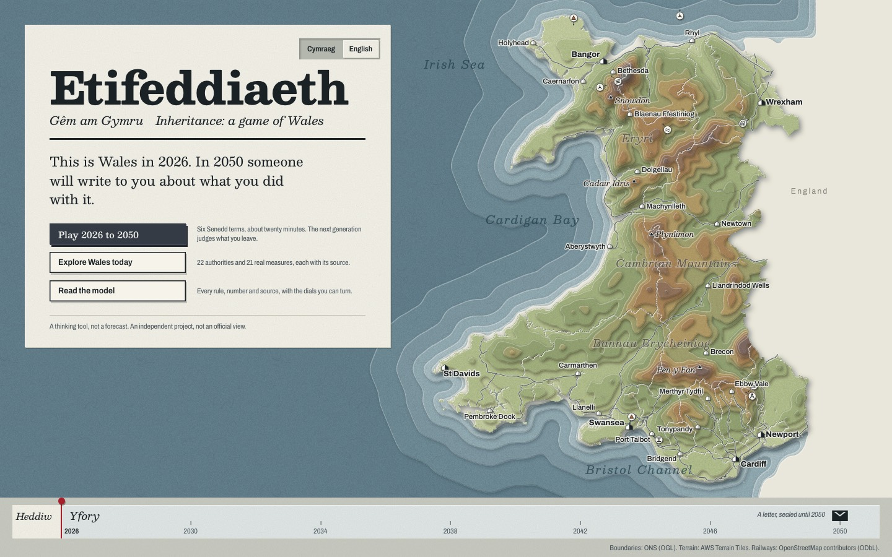
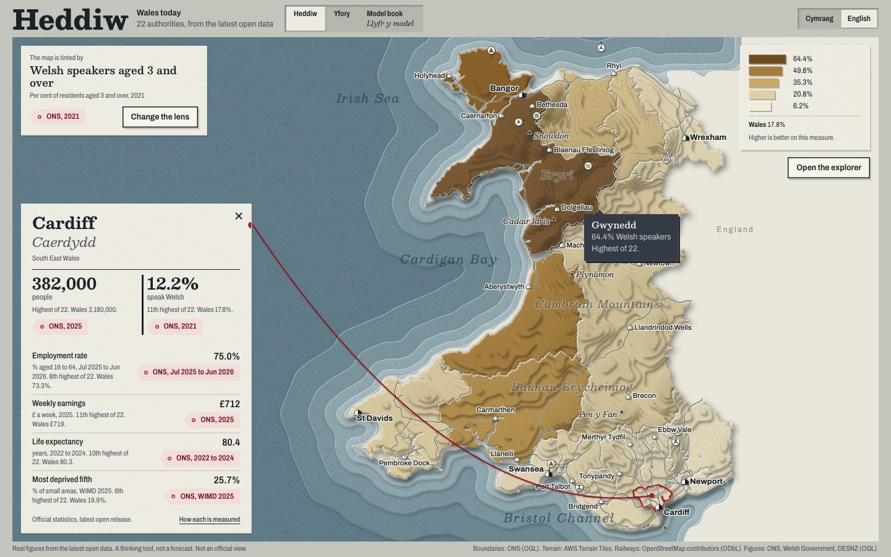
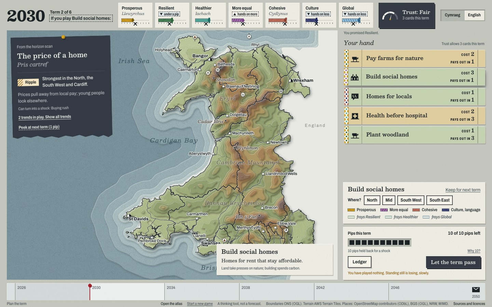
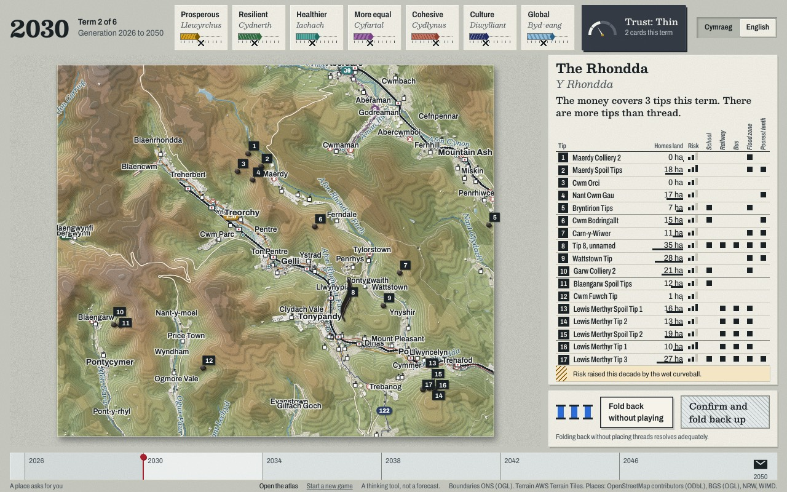
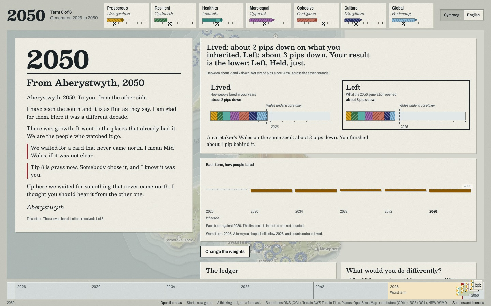

# Etifeddiaeth (Inheritance): a game of Wales

*Gêm am Gymru.* A strategy game and atlas of Wales built on real open data. You govern Wales term by term from 2026 to 2050, and the next generation judges what you left them.

**Play:** https://etifeddiaeth.web.app

> An independent project and a thinking tool, not a forecast and not an official view of any organisation.



## What is in it

- **Heddiw (Wales today):** the 22 local authorities on a paper relief map, with 19 real measures as map lenses, a panel per authority with sources, and an explorer table and scatter.
- **Yfory (2026 to 2050):** six Senedd terms. Play policy cards on real places, face curveballs from a horizon scan of Wales, visit the Rhondda or Dyffryn Ogwen to make a hard local choice on real streets, and read the letter from 2050. You are judged on the lower of what people **Lived** through and what you **Left**, so you cannot win by borrowing from the future.
- **Llyfr y model (the model book):** every rule, indicator and source, readable by anyone, with dials you can turn. Change one and the game tells you that you are playing a modified rule set.

| Heddiw: the atlas | Yfory: a term in play |
|---|---|
|  |  |
| **The Rhondda: which tips first** | **2050: the letter and the verdict** |
|  |  |

Every relationship is a rule written as data in `model/`, with its sources, parameter ranges and a confidence grade. Every figure on screen traces back to a source ("pull the thread").

## Run it

```bash
npm install
npm run dev        # builds the model, then serves at http://localhost:5173
npm test           # engine, model and UI unit tests
npm run e2e        # Playwright end-to-end, with an accessibility scan, in English and Welsh
npm run typecheck
npx tsx scripts/balance.ts   # bot players over 200 seeds against the balance targets
```

## Where things are

| Path | What |
|---|---|
| `docs/spec.md` | What v1 is, and the settled decisions |
| `docs/design/game-design.md` | The game: term loop, strands, Trust, Lived and Left, cards, curveballs, places, voices, the 8/10 checklist |
| `docs/design/design-system.md`, `tokens.css` | The look: paper, print and weave; Besley and Archivo |
| `docs/design/balance-decision.md`, `balance-log.md` | How the scoring was tuned, and why |
| `docs/design/playtest-*.md` | Playtest reports against the 8/10 checklist (their screenshots stay local in `design/shots-build/`, which is not committed) |
| `docs/adr/` | Decisions that are hard to reverse |
| `docs/data-licences.md` | Every dataset, its licence and the attribution it needs |
| `GLOSSARY.md` | The words, in English and Welsh |
| `model/` | Rules, cards, curveballs, places, voices, letters, indicators, sources and data, as YAML and JSON |
| `pipeline/` | Python that fetches the open data into `model/data/` |
| `src/engine/` | The simulation: pure TypeScript, deterministic, seeded |
| `src/map/` | The paper relief map renderer |
| `src/ui/` | Solid components: shell, atlas, game, places, end, model book |

## Changing the model

Relationships live in `model/rules/*.yaml`, never in code. Each rule has a kind (linear, saturating, stock, threshold, fcm, io), inputs, output, parameters with ranges, sources and a confidence grade. Run `npm run model:build` to validate: it refuses a rule with no source, a missing Welsh field or a parameter out of range.

## Welsh

Every string exists in English and Welsh. Much of the Welsh is a draft awaiting a fluent reviewer; those strings are flagged `cy_review` and listed when the model builds.

## Data and licences

Code: MIT. Model rules and content in `model/`: CC BY 4.0. Data keeps its source licence: ONS, Welsh Government, DESNZ and Natural Resources Wales data under the Open Government Licence v3.0; OpenStreetMap data under the ODbL; terrain from AWS Terrain Tiles. See `docs/data-licences.md` for the attribution each needs. The Welsh Government register of disused coal tips is not open data and is not used: coal tips in the game come from open proxies (British Geological Survey landslide records and OpenStreetMap) and are labelled as such.
